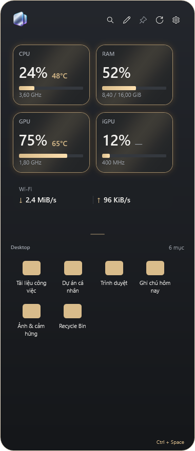

<p align="center"></p>
<h1 align="center">Nepply</h1>
<p align="center"><strong>A tidier desktop. Your apps and system stats, within reach.</strong></p>
<p align="center"><strong>English</strong> · <a href="README.vi.md">Tiếng Việt</a></p>
<p align="center"><a href="#-download">Download</a> · <a href="docs/USER_GUIDE.en.md">User guide</a> · <a href="CHANGELOG.en.md">What's new</a> · <a href="docs/README.md">Documentation</a></p>

> **2.0.0 release candidate · testers wanted**
>
> This build is not code-signed, so Windows may warn you. Developers and power users: try it on your hardware and tell us what happened. [Testing guide →](docs/TESTING.en.md)

## ✨ A small panel, close at hand

Nepply sits at the edge of your Windows screen. Open Desktop items, search by name and check CPU, RAM, GPU/iGPU and network activity without returning to the desktop.

| | What you can do |
| --- | --- |
| 🖱️ Quick access | Open from your chosen screen edge or a hotkey; pin the panel when needed. Every shortcut can be changed. |
| 🔎 Desktop search | Find and launch items, with the Windows context menu. Your files stay where they are. |
| 🎨 Make it yours | Light/dark/system theme, colors, neon and metallic effects, with live preview before saving. |
| 📐 Flexible layout | Choose columns × rows with the dot grid; scroll through additional items. |
| 🙈 Clean Desktop | Hide Desktop icons to keep your wallpaper clear while still opening items from the panel; icons return when you exit. |
| 📊 System overview | CPU, RAM, GPU/iGPU and upload/download rates. Sensor availability depends on your hardware. |
| 🎮 Game-aware edges | Avoid automatic edge opening while a game hides the pointer for character control. Behavior depends on the game. |

The app supports Vietnamese, English, Japanese, German, Simplified Chinese, Russian, French and Thai.

## 🖼️ Panel & Settings

<table>
<tr><th>Desktop panel</th><th>Settings · wide layout</th></tr>
<tr>
<td valign="top" width="32%"></td>
<td valign="top" width="68%"></td>
</tr>
</table>

Rendered directly from Nepply using sample items and illustrative numbers (Vietnamese UI). Settings switches to horizontal tabs in narrow windows. [About these screenshots →](docs/images/README.md)

## 📦 Download

**Windows 10 version 2004 (build 19041) or later / Windows 11 · x64**

| Choose | File | How to use |
| --- | --- | --- |
| **Setup — recommended** | `Nepply-<version>-Setup.exe` | Run the installer. Uninstall through Windows Installed apps. |
| **Portable** | `Nepply-<version>-win-x64-portable.zip` | Extract everything, then run `Nepply.exe`. Keep `guardian` and all companion files. |

[Open GitHub Releases →](https://github.com/minhquang0607/Nepply/releases)

`<version>` is the version shown on the Releases page. Choose the file under **Assets**. GitHub's “Source code” archives are for developers, not ready-to-run apps. Both distributions bundle .NET; no SDK installation is needed. Portable still stores settings in your Windows user profile.

Only use the official release channel. If Windows blocks a file, check its source and release information. **Do not disable Windows protection to run Nepply.**

<details>
<summary><strong>Check a download (optional)</strong></summary>

Until Nepply is code-signed, these checks show that a file is the one this repository published:

1. **Not damaged in transfer.** In PowerShell, in the folder with the file:

   ```powershell
   Get-FileHash .\Nepply-<version>-Setup.exe -Algorithm SHA256
   ```

   Compare the result with the file's line in `SHA256.json`, or with the `sha256:` value GitHub shows next to the file under **Assets**. Both come from the same release page, so this catches a damaged download, not a forged release.

2. **Built by this repository.** With the [GitHub CLI](https://cli.github.com/) signed in:

   ```powershell
   gh attestation verify .\Nepply-<version>-Setup.exe --repo minhquang0607/Nepply
   ```

   It succeeds only for a file that this repository's release workflow built and attested. Every file on the Releases page has an attestation.

</details>

## 🚀 Get started

1. Open Nepply and choose a screen edge.
2. Move to that edge. If you prefer a key, set one in Settings → Shortcuts.
3. Open a Desktop item or search by name.
4. Try changes in Settings: **Apply** saves and stays open; **OK** saves and closes; **Cancel** discards changes since the last save.
5. To quit completely, choose **Exit** from the tray icon.

[User guide](docs/USER_GUIDE.en.md) · [Troubleshooting](docs/TROUBLESHOOTING.en.md)

## 🛡️ Privacy & support

No ads, analytics or automatic crash uploads. Update checks contact GitHub once a day (again after 12 hours if a check fails) and when requested; you can turn the daily check off. [Privacy policy — EN / VI](docs/legal/PRIVACY.md) · [Terms of use — EN / VI](docs/legal/TERMS.md#english)

- [Report a bug or suggest a feature](https://github.com/minhquang0607/Nepply/issues). Include your version and steps; redact personal data from screenshots/logs.
- Tried a release candidate? Share what worked and what did not with the [test report form](https://github.com/minhquang0607/Nepply/issues/new?template=test_report.yml). See the [testing guide](docs/TESTING.en.md).
- Security concerns: use the [private reporting channel — EN / VI](docs/legal/SECURITY.md), not a public exploit report.
- Automatic EXE installation is not enabled for public release; portable cannot replace its own files yet. Microsoft Store distribution is not published.

## 🧩 Source & license

Built by **Minh Quang** with WPF / .NET. AI team: Codex and Claude. Nepply-owned code uses the [MIT License](LICENSE); dependencies retain their [own licenses and notices](docs/legal/THIRD_PARTY_NOTICES.md).

[Contribute / build](CONTRIBUTING.en.md) · [Documentation](docs/README.md) · [Code signing policy](docs/release/CODE_SIGNING_POLICY.en.md) · [Code of conduct](CODE_OF_CONDUCT.md)
