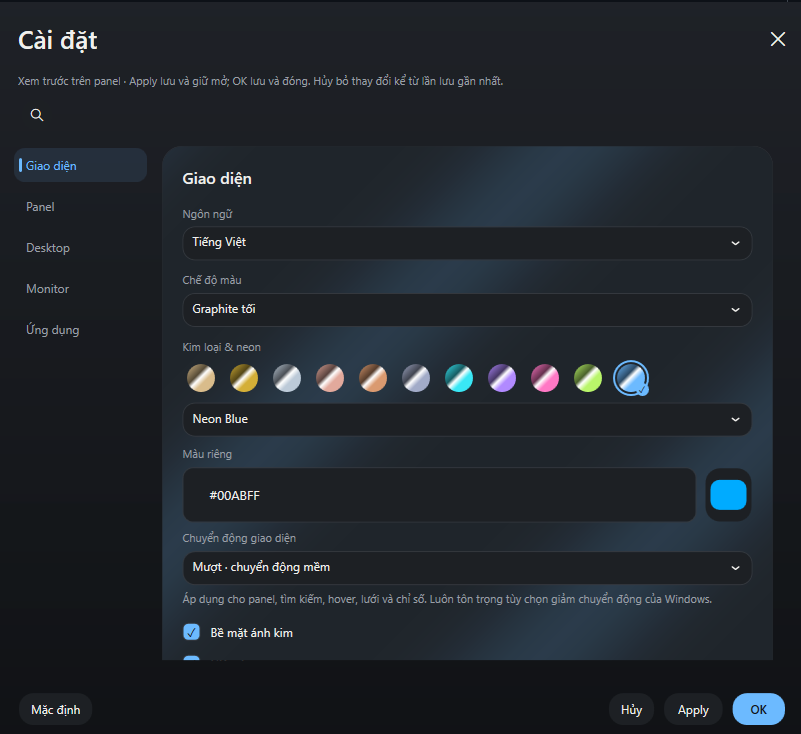

# Nepply

**Desktop gọn hơn. Ứng dụng và thông số hệ thống luôn trong tầm tay.**

Nepply là panel ở cạnh màn hình Windows, giúp bạn mở nhanh các mục trên Desktop, tìm kiếm và xem CPU, RAM, GPU cùng tốc độ mạng mà không cần quay về màn hình nền.

> **1.0.0 · Đang chuẩn bị phát hành.** Chưa có bản tải chính thức đã ký số. Mã nguồn hiện có để tham khảo và tự build; không nên xem bản build thử là bản ổn định cho sử dụng rộng rãi.

## Bạn có thể làm gì với Nepply?

- **Mở nhanh từ cạnh màn hình:** chọn cạnh đặt panel, dùng phím tắt hoặc ghim panel khi cần.
- **Tìm và mở mục Desktop:** xem icon, tìm theo tên và sử dụng menu chuột phải của Windows. Nepply không di chuyển file Desktop sang một nơi khác.
- **Sắp xếp vừa mắt:** chọn số cột × hàng bằng lưới chấm tròn; cuộn để xem các mục vượt vùng hiển thị.
- **Xem hoạt động của máy:** theo dõi CPU, RAM, GPU/iGPU và tốc độ tải xuống/tải lên. Số đo cảm biến tùy phần cứng và khả năng truy cập của Windows.
- **Tùy chỉnh giao diện:** nền sáng/tối/theo hệ thống, bảng màu, neon và ánh kim; xem thay đổi trên panel trước khi lưu.
- **Hạn chế làm phiền khi chơi game:** không tự mở từ cạnh khi con trỏ đang bị ẩn để điều khiển nhân vật. Khả năng nhận biết còn tùy trò chơi.

Giao diện có tiếng Việt, Anh, Nhật, Đức, Trung giản thể, Nga, Pháp và Thái.

## Xem giao diện

Ảnh cửa sổ ứng dụng do chủ dự án cung cấp ngày 17/10/2026, giữ nguyên nội dung. Settings dùng menu dọc ở chiều rộng thông thường và chuyển thành tab ngang khi cửa sổ hẹp. Ảnh này minh họa giao diện, không phải bằng chứng xác nhận phiên bản binary hoặc kết quả QA.

## Tải và cài đặt

Nepply dành cho **Windows 10 phiên bản 2004 (build 19041) trở lên và Windows 11, kiến trúc x64**.

Khi bản chính thức sẵn sàng, các tệp tải sẽ xuất hiện tại [GitHub Releases](https://github.com/minhquang0607/Nepply/releases):

| Bản | Tệp tải dự kiến cho 1.0.0 | Cách dùng |
| --- | --- | --- |
| **Setup — khuyên dùng** | `Nepply-1.0.0-Setup.exe` | Chạy bộ cài; gỡ qua danh sách ứng dụng của Windows. |
| **Portable** | `Nepply-1.0.0-win-x64-portable.zip` | Giải nén toàn bộ rồi chạy `Nepply.exe`. Giữ thư mục `guardian` và các file đi kèm. |

**Chưa mở tải:** các tên trên là tệp dự kiến, không phải liên kết tới bản đã phát hành. Khi release được công bố, chọn tệp trong mục **Assets**; `Source code (zip/tar.gz)` là mã nguồn, không phải ứng dụng để chạy. Portable không cần cài đặt nhưng vẫn lưu cấu hình trong tài khoản Windows. Cả hai bản dự kiến đóng gói sẵn .NET, không yêu cầu cài SDK.

Không tải các bản đóng gói lại không rõ nguồn gốc. Nếu Windows chặn một tệp, hãy kiểm tra nguồn tải và thông tin bản phát hành; **không tắt bảo vệ Windows để chạy Nepply**.

## Bắt đầu sử dụng

1. Mở Nepply và chọn cạnh màn hình bạn muốn dùng.
2. Đưa chuột tới cạnh đã chọn, hoặc nhấn **Ctrl + Space** nếu chưa đổi phím tắt.
3. Chọn một mục Desktop để mở; dùng ô tìm kiếm khi cần tìm nhanh.
4. Mở **Cài đặt**, thử giao diện và bố cục ngay trên panel. **Apply** lưu và giữ cửa sổ mở; **OK** lưu rồi đóng; **Hủy** bỏ những thay đổi chưa lưu.
5. Khi muốn thoát hẳn, chọn **Thoát** từ biểu tượng Nepply ở khay hệ thống.

Đọc [hướng dẫn sử dụng](docs/USER_GUIDE.md) để chỉnh lưới, monitor, tự khởi động và cập nhật; xem [xử lý sự cố](docs/TROUBLESHOOTING.md) nếu có điều gì chưa hoạt động như mong đợi.

## Quyền riêng tư và hỗ trợ

Nepply không có quảng cáo, analytics hay tự gửi báo cáo lỗi. Kiểm tra cập nhật kết nối tới GitHub khi bạn chủ động yêu cầu. Xem [chính sách quyền riêng tư](docs/legal/PRIVACY.md).

- Gặp lỗi hoặc muốn đề xuất tính năng? [Tạo issue](https://github.com/minhquang0607/Nepply/issues), kèm phiên bản, các bước tái hiện và ảnh đã che dữ liệu cá nhân.
- Vấn đề bảo mật: dùng [kênh báo cáo riêng](docs/legal/SECURITY.md), không đăng cách khai thác hoặc thông tin nhạy cảm vào issue công khai.
- Xem [những thay đổi](CHANGELOG.md) và [bản đồ tài liệu](docs/README.md).

## Mã nguồn và giấy phép

Nepply được phát triển bởi **Minh Quang** bằng WPF / .NET. Mã do dự án sở hữu được cung cấp theo [MIT License](LICENSE); thư viện bên thứ ba giữ [giấy phép và thông báo riêng](docs/legal/THIRD_PARTY_NOTICES.md).

Muốn tự build hoặc đóng góp? Bắt đầu tại [CONTRIBUTING](CONTRIBUTING.md). Thông tin ký phát hành: [Code signing policy](docs/release/CODE_SIGNING_POLICY.md).
