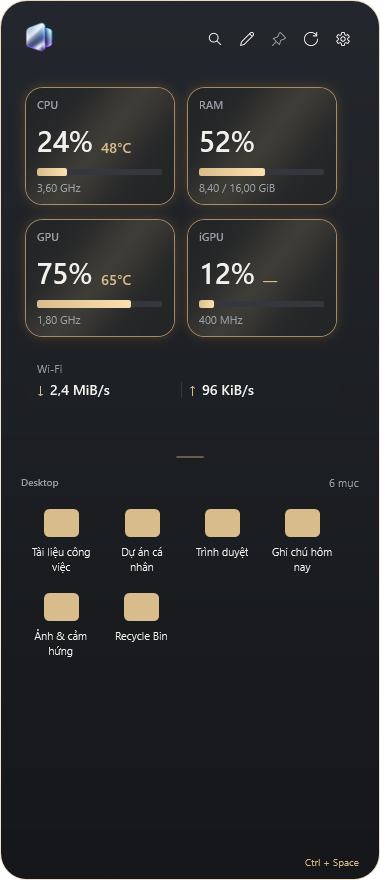
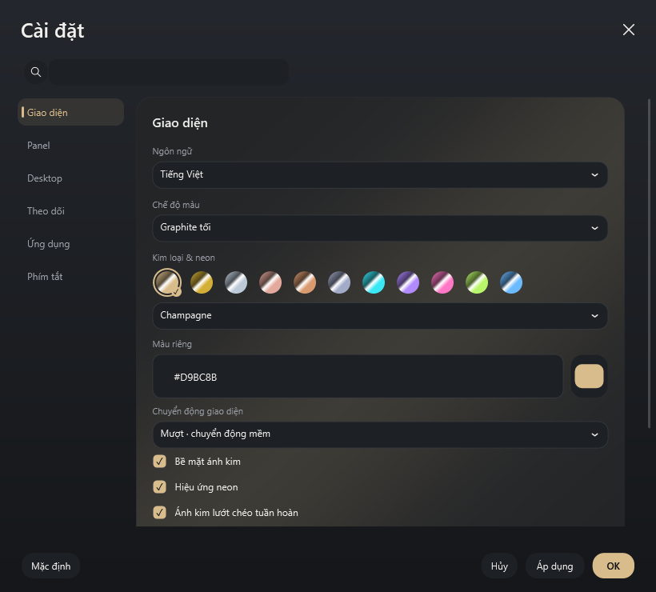

<h1 align="center">Nepply</h1>

<strong>Desktop gọn hơn. Ứng dụng và thông số hệ thống luôn trong tầm tay.</strong>

<a href="README.md">English</a> · <strong>Tiếng Việt</strong>

<a href="#-tải-ứng-dụng">Tải ứng dụng</a> · <a href="docs/USER_GUIDE.md">Hướng dẫn</a> · <a href="CHANGELOG.md">Có gì mới</a> · <a href="docs/README.md">Tài liệu</a>

> **1.0.0-beta.1 · Đang chuẩn bị bản beta công khai đầu tiên (chưa ký)**
>
> Chưa có bản tải chính thức đã ký số. Release trên GitHub vẫn là bản nháp; bản build nội bộ không phải binary phát hành công khai.

## ✨ Panel nhỏ, tiện ngay bên cạnh

Nepply nằm ở cạnh màn hình Windows. Mở mục Desktop, tìm theo tên và xem CPU, RAM, GPU/iGPU cùng tốc độ mạng mà không cần quay về màn hình nền.

| | Bạn có thể làm gì? |
| --- | --- |
| 🖱️ Mở nhanh | Mở từ cạnh màn hình hoặc phím tắt; ghim panel khi cần giữ mở. |
| 🔎 Tìm trên Desktop | Tìm và mở mục, dùng menu chuột phải Windows. File vẫn ở vị trí cũ. |
| 🎨 Cá nhân hóa | Sáng/tối/theo hệ thống, bảng màu, neon và ánh kim; xem trước trước khi lưu. |
| 📐 Bố cục linh hoạt | Chọn cột × hàng bằng lưới chấm tròn; cuộn để xem các mục còn lại. |
| 📊 Theo dõi máy | CPU, RAM, GPU/iGPU và tốc độ tải lên/xuống. Cảm biến tùy phần cứng. |
| 🎮 Hạn chế làm phiền game | Không tự mở cạnh khi game ẩn chuột để điều khiển nhân vật. Hành vi tùy từng game. |

Ứng dụng hỗ trợ tiếng Việt, Anh, Nhật, Đức, Trung giản thể, Nga, Pháp và Thái.

## 🖼️ Panel & Cài đặt

<table>
<tr><th>Panel Desktop</th><th>Cài đặt · bố cục rộng</th></tr>
<tr>
<td valign="top" width="32%"></td>
<td valign="top" width="68%"></td>
</tr>
</table>

Ảnh render mới từ cùng **build Release 1.0.0**, source `15cdbb2`. Đây là các view WPF thật trong fixture UI cô lập, không phải ảnh Desktop cá nhân. Tên mục, icon và số đo panel là dữ liệu minh họa; ảnh dùng giao diện tiếng Việt. Settings chuyển sang tab ngang khi cửa sổ hẹp. [Nguồn ảnh →](docs/images/README.md)

## 📦 Tải ứng dụng

**Windows 10 phiên bản 2004 (build 19041) trở lên / Windows 11 · x64**

| Lựa chọn | Tệp dự kiến | Cách dùng |
| --- | --- | --- |
| **Setup — khuyên dùng** | `Nepply-1.0.0-beta.1-Setup.exe` | Chạy bộ cài; gỡ qua danh sách ứng dụng của Windows. |
| **Portable** | `Nepply-1.0.0-beta.1-win-x64-portable.zip` | Giải nén toàn bộ rồi chạy `Nepply.exe`. Giữ `guardian` và các file đi kèm. |

[Mở GitHub Releases →](https://github.com/minhquang0607/Nepply/releases)

**Chưa mở tải.** Khi công bố, chọn tệp trong **Assets**. Các gói “Source code” của GitHub là mã nguồn cho người phát triển, không phải app chạy ngay. Cả hai bản đóng gói sẵn .NET, không cần cài SDK. Portable vẫn lưu cấu hình trong tài khoản Windows.

Chỉ tải từ kênh phát hành chính thức. Nếu Windows chặn file, kiểm tra nguồn và thông tin release. **Không tắt bảo vệ Windows để chạy Nepply.**

## 🚀 Bắt đầu

1. Mở Nepply và chọn cạnh màn hình.
2. Đưa chuột tới cạnh đó hoặc nhấn **Ctrl + Space** nếu chưa đổi phím tắt.
3. Mở một mục Desktop hoặc tìm theo tên.
4. Thử thay đổi trong Cài đặt: **Apply** lưu và giữ mở; **OK** lưu rồi đóng; **Hủy** bỏ phần thay đổi kể từ lần lưu gần nhất.
5. Muốn thoát hẳn, chọn **Thoát** ở biểu tượng khay hệ thống.

[Hướng dẫn sử dụng](docs/USER_GUIDE.md) · [Xử lý sự cố](docs/TROUBLESHOOTING.md)

## 🛡️ Quyền riêng tư & hỗ trợ

Không quảng cáo, analytics hay tự gửi báo cáo lỗi. Kiểm tra cập nhật chỉ kết nối GitHub khi bạn yêu cầu. [Quyền riêng tư — EN / VI](docs/legal/PRIVACY.md)

- [Báo lỗi hoặc đề xuất](https://github.com/minhquang0607/Nepply/issues): ghi phiên bản và bước tái hiện; che dữ liệu cá nhân trong ảnh/log.
- Lỗ hổng bảo mật: dùng [kênh liên hệ riêng — EN / VI](docs/legal/SECURITY.md), không đăng cách khai thác công khai.
- Tự cài cập nhật EXE chưa mở cho phát hành; portable chưa tự thay file. Chưa công bố bản Microsoft Store.

## 🧩 Mã nguồn & giấy phép

Phát triển bởi **Minh Quang** bằng WPF / .NET. Mã Nepply sở hữu dùng [MIT License](LICENSE); thư viện giữ [giấy phép và thông báo riêng](docs/legal/THIRD_PARTY_NOTICES.md).

[Đóng góp / tự build](CONTRIBUTING.md) · [Tài liệu](docs/README.md) · [Chính sách ký mã](docs/release/CODE_SIGNING_POLICY.md) · [Quy tắc ứng xử](CODE_OF_CONDUCT.md)
