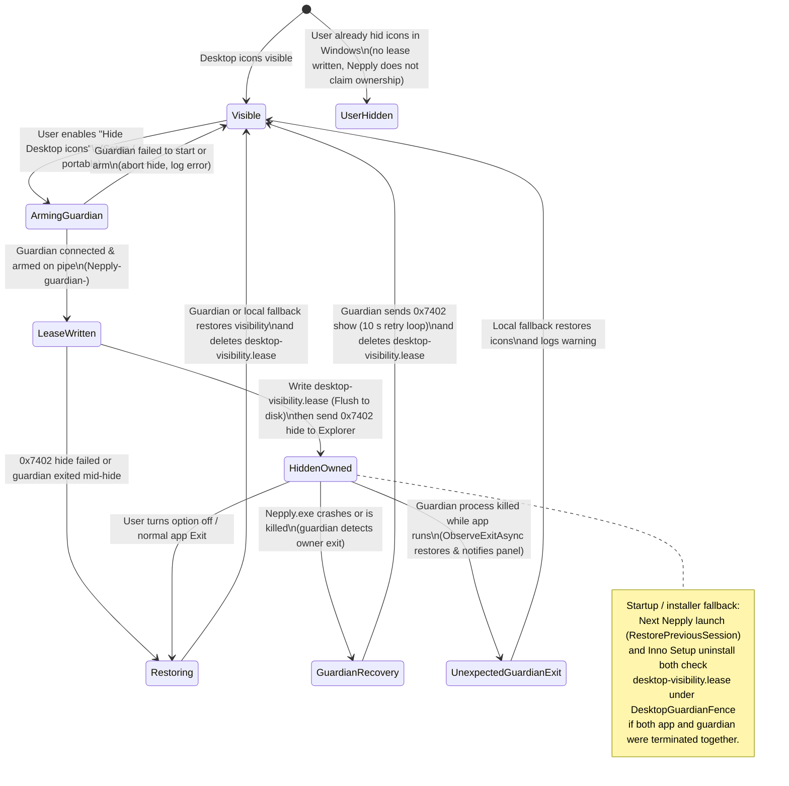

# Nepply module boundaries

**English** · [Tiếng Việt](MODULES.md) · [Documentation](../README.md) · [Structure](STRUCTURE.en.md)

Current architecture for **2.0.0** (updated 14 November 2026). See the [directory layout](STRUCTURE.en.md). This document describes module responsibilities, process boundaries and state transitions; it is not a refactor log or a runtime certification.

## Principles

Nepply is a WPF modular monolith, not a plugin framework. Boundaries follow runtime risk and lifecycle ownership: code that calls into Windows Shell extensions or hardware sensor libraries runs out-of-process so a hang or native crash cannot bring down the UI panel. Do not add assemblies, timers or dependencies solely to create layers. Compatibility namespaces (`Nepply.Services`, `Nepply.Views`, `Nepply.Modules`) do not imply separate assemblies.

## Runtime process boundaries

At runtime, Nepply splits work across up to four processes under the current Windows user account. All inter-process communication uses `CurrentUserOnly` named pipes (`Nepply-*`) with two-way PID and process start-time verification (`HelperPipeIdentity`).

```mermaid
flowchart LR
    subgraph UI["Nepply.exe (UI process)"]
        MW["MainWindow / Panel UI"]
        DIS["DesktopIconService"]
        HMS["HardwareMonitorService"]
    end

    subgraph DH["Nepply.exe --desktop-host"]
        Scan["Shell / Desktop enumeration\n& icon extraction (per scan)"]
    end

    subgraph SH["Nepply.exe --sensor-host"]
        LHM["LibreHardwareMonitor\n(reused, idle timeout 10 min)"]
    end

    subgraph GD["Nepply.DesktopGuardian.exe"]
        Guard["Owner exit watcher &\n0x7402 Desktop recovery"]
    end

    EXP["Windows Explorer\n(SHELLDLL_DefView / SysListView32)"]
    LEASE[("%LOCALAPPDATA%\\Nepply\\\ndesktop-visibility.lease")]

    DIS -- "Named pipe (bounded JSON + PNG budget,\n25–30 s deadline)" --> Scan
    HMS -- "Named pipe (on-demand sample\nwhile panel/preview open)" --> LHM
    DIS -- "Named pipe (1-byte Arm / Restore,\nSetup & portable only)" --> Guard
    DIS -- "Write before hide /\ndelete after restore" --> LEASE
    DIS -- "0x7402 toggle (Setup/portable)\nor ShowWindow (Store)" --> EXP
    Guard -- "WaitForExitAsync(owner)\n→ 0x7402 restore + clear lease" --> EXP
    Guard -. "Clear completed lease" .-> LEASE
```

- **`Nepply.exe` (UI process):** Hosts the WPF panel, Settings, tray icon, edge pointer polling, hotkeys and update checks. Never loads third-party Shell context-menu handlers during background scans and never loads `LibreHardwareMonitorLib` in-process.
- **`Nepply.exe --desktop-host` (`DesktopScanProcess`):** Short-lived child process spawned per full or incremental Desktop scan. Reads user/Public Desktop folders and Shell namespace items, renders icon bitmaps within `DesktopImageBudget` and returns a bounded payload. A faulty Shell extension is isolated to one scan attempt; bad individual entries are skipped and logged rather than aborting the entire snapshot.
- **`Nepply.exe --sensor-host` (`SensorProcessProvider`):** Out-of-process hardware reader hosting `LibreHardwareMonitorLib`. Pre-warmed when the pointer approaches the active screen edge and kept alive for up to 10 minutes between opens so opening the panel does not pay cold-start cost. Sleeps when the panel is hidden.
- **`Nepply.DesktopGuardian.exe` (`GuardedDesktopVisibility`, Setup & portable only):** Lightweight non-WPF helper started only while Nepply hides Desktop icons. Authenticates the owner process by PID, UTC `StartTime` ticks and session ID, acquires the cross-process `DesktopGuardianFence` and waits for either a `Restore` pipe command or owner process termination.

## Desktop icon hiding and recovery states

Nepply never claims ownership of a Desktop that the user had already hidden before Nepply hid it. Two mechanisms exist depending on how the app is packaged:

1. **Setup and portable (`ExplorerDesktopVisibility` + `GuardedDesktopVisibility`):** Toggles Explorer's `SHELLDLL_DefView` via `WM_COMMAND` `0x7402`. Because Explorer persists that setting across logoffs, Nepply writes `%LOCALAPPDATA%\Nepply\desktop-visibility.lease` (`restore-visible-v1`) *before* hiding and keeps `Nepply.DesktopGuardian.exe` armed while hidden.
2. **Microsoft Store / MSIX (`WindowDesktopVisibility`, currently parked):** Calls `ShowWindow` on Explorer's icon list window (`SysListView32`) without changing persistent Explorer settings or spawning a guardian. If Explorer restarts while Nepply is running (`TaskbarCreated`), `MainWindow` hides the icon window again.

## Desktop: read → reconcile → present

- `Discovery` enumerates Desktop/Shell items and extracts icons; `DesktopScanOptions` captures a snapshot of scan settings for each run.
- `State` holds the catalog snapshot; `Watching` coalesces `FileSystemWatcher` and `SHChangeNotifyRegister` events (`DesktopWatcherService`, `DesktopShellNotifications`) plus a periodic 5-minute reconciliation timer. `DesktopUpdateCoordinator` owns watcher subscriptions and triggers a refresh on system resume.
- `IDesktopCatalog` exposes snapshots and status; `IDesktopActions` exposes refresh, item launch (`ShellLaunchQueue`, non-blocking off the UI thread) and Shell context menus. `DesktopIconService` implements both.
- `DesktopIconViewModel` filters/sorts items and surfaces status messages to the UI. `DesktopIconCollection` batches collection updates; `IconGridPanel` handles virtualization and scroll anchoring; `IconGridGeometry` shares arrange/drop math.
- `ShellContextMenu` in `Platform/Windows/Shell` owns COM pointers and native menus for a single invocation. Views never release service-owned native handles directly.

## Lifecycle ownership and shutdown

`WindowServices` wires the Desktop, watcher and telemetry services and transfers ownership to `MainWindow`. On exit, the host detaches UI subscriptions before disposing services. `CleanupSequence` runs every cleanup step even if an earlier step throws. Recovery is best-effort and cannot be guaranteed if both `Nepply.exe` and `Nepply.DesktopGuardian.exe` are killed simultaneously while Explorer is unresponsive, though the next launch or uninstaller will retry from `desktop-visibility.lease`.

## Panel and interaction

`PanelGeometry` computes physical and DPI-scaled bounds from monitor work areas; `MainWindow` selects the target display and applies WPF/Win32 window placement. `PanelDimensions` holds sizing rules; gates under `Features/Panel/Interaction` (`PointerActivationGate`, `EdgeHitTest`, `GameModeDetector`) decide edge reveal, taskbar-corner avoidance, pointer capture suppression during full-screen games and auto-collapse.

`LayoutEditSession` manages snapshot, dirty tracking, commit and cancel for in-panel widget arrangement. Do not confuse it with the icon grid row/column setting in Settings.

## Settings

`SettingsEditSession` holds a mutable draft and validates candidates before publishing to the live `AppSettings` instance; `SettingsChangeSet` classifies which subsystems need live preview vs save-time application. **Apply** saves and stays open; **OK** saves and closes; **Cancel** reverts unsaved preview changes.

`SettingsStore` handles atomic JSON writes (`Flush(true)` + `File.Replace` + `.bak`), corrupt-file quarantine and forward-compatible read-only mode when encountering a newer schema version. `InstallerChoices` reads one-time language and auto-start handoff keys written by Inno Setup (`HKCU\Software\Nepply\Setup`).

## Telemetry

`ISensorProvider` → `HardwareMonitorService` → immutable snapshot / ViewModel → `MonitorPanel` and `MetricReadingView`. Collectors never reference WPF windows; views never query hardware directly. `MetricValue` validates ranges and NaN/infinity; `SensorProcessProvider` isolates `LibreHardwareMonitorLib` behind a named pipe and falls back to Windows performance counters when hardware sensors are unavailable or blocked by policy.

Scope is strictly CPU, RAM, GPU/iGPU and network adapter byte counters. Missing readings display as unavailable (`—`), never fabricated numbers. Nepply installs no kernel drivers and never asks users to weaken OS or anti-cheat protections.

## Search and appearance

`SearchSession` owns query state and debounce timers; `SearchReveal` drives clip/translation animations on the host dispatcher. Settings search uses an overlay within the same visual tree rather than a second window.

`Presentation/Appearance` contains themes, tokens and control templates. `AccentPalette` computes contrast-safe colors; `ThemeService` updates merged WPF resource dictionaries. `MetallicSurface` and material controls detach animation clocks when unloaded or when Windows animations / High Contrast are disabled.

Localization lives in `Resources/Strings.json` across 8 languages (`vi`, `en`, `ja`, `de`, `zh`, `ru`, `fr`, `th`). Changing language updates bindings in place without restarting hardware samplers.

## Updates

`Features/Updates` handles version comparison, GitHub Releases feed parsing, `release-notes.json` multi-version summaries, bounded downloads and native `WinVerifyTrust` + SPKI certificate pinning (`AuthenticodeVerifier`, `SignerRule`). `UpdateWindow.xaml` renders plain-text notes and never executes downloaded content while `UpdatePolicy.Signers` is empty (unsigned release candidates open the GitHub Release page in the browser instead).

## Known coupling and planned refactors

`MainWindow` (~966 lines) and `SettingsWindow` (~753 lines) still coordinate too many UI concerns directly, and `AppSettings` still calls into presentation services. Planned post-RC cleanups are tracked under Phase 10 of [PUBLIC_RELEASE_CHECKLIST.md](../release/PUBLIC_RELEASE_CHECKLIST.md): extracting focused controllers (`PanelActivationController`, `SettingsPreviewCoordinator`), making `AppSettings` pure data, aligning legacy `Nepply.Services` namespaces with folder paths, and migrating the custom test runner in `tests/Nepply.Tests/Program.cs` to xUnit/MSTest incrementally.
