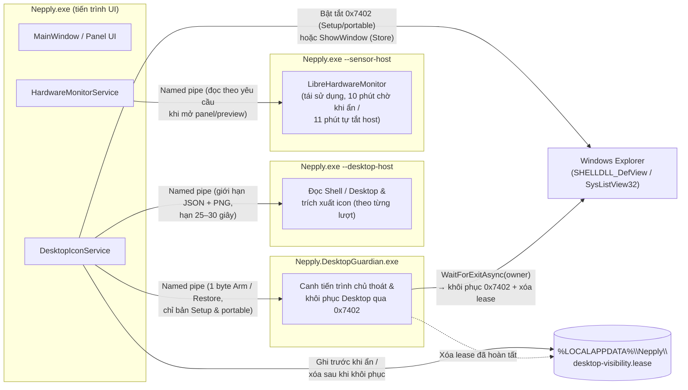
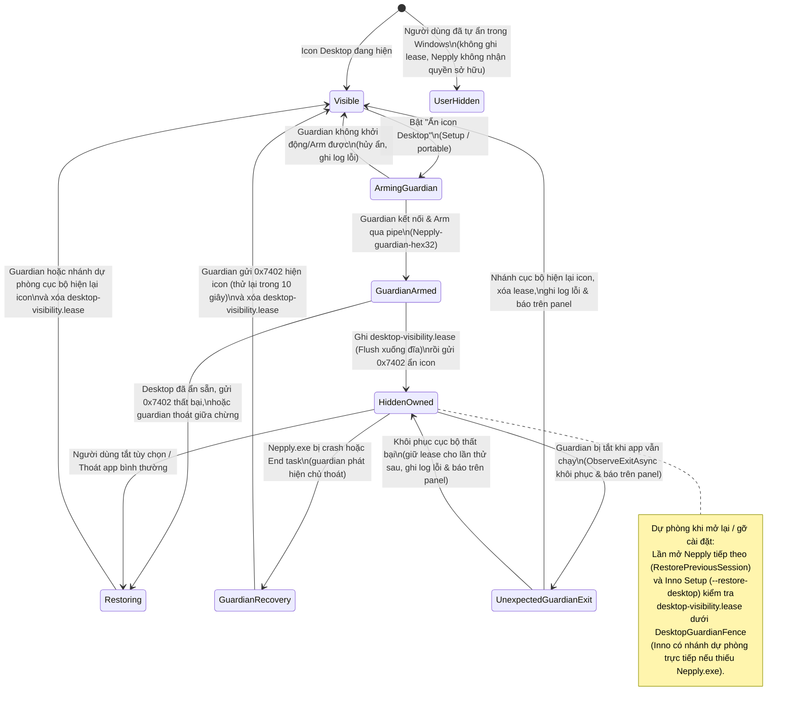

# Ranh giới module Nepply

[English](MODULES.en.md) · **Tiếng Việt** · [Tài liệu](../README.md) · [Cấu trúc](STRUCTURE.md)

Kiến trúc hiện hành của **2.0.0**, cập nhật 14/11/2026. Xem [cây thư mục](STRUCTURE.md). Đây là bản đồ trách nhiệm, ranh giới tiến trình và chuyển trạng thái, không phải nhật ký refactor hay chứng nhận runtime.

## Nguyên tắc

Nepply là modular monolith WPF, không phải hệ thống plugin. Tách theo trách nhiệm và vòng đời; không tạo project, timer hoặc dependency chỉ để chia lớp. Namespace tương thích như Services/Views/Modules không có nghĩa là assembly độc lập.

## Ranh giới tiến trình lúc chạy

Lúc chạy, Nepply tách công việc ra tối đa bốn tiến trình dưới cùng tài khoản người dùng Windows hiện tại. Mọi giao tiếp liên tiến trình dùng named pipe `CurrentUserOnly` (`Nepply-*`) có xác thực PID hai chiều và ghim handle tiến trình cha (`HelperPipeIdentity`), kèm xác thực một chiều `StartTime` (UTC ticks) và session ID của tiến trình chủ bên trong `Nepply.DesktopGuardian.exe`.

- **`Nepply.exe` (tiến trình UI):** Chạy giao diện WPF, Cài đặt, khay hệ thống, polling con trỏ ở cạnh, hotkey và kiểm tra cập nhật. Không nạp Shell extension bên thứ ba khi quét nền và không nạp `LibreHardwareMonitorLib` trong tiến trình giao diện.
- **`Nepply.exe --desktop-host` (`DesktopScanProcess`):** Tiến trình con sống ngắn cho mỗi lượt quét Desktop đầy đủ hoặc từng phần. Một Shell extension lỗi bị cô lập trong lượt quét đó; mục đơn lẻ bị lỗi được bỏ qua và ghi log thay vì làm hỏng cả danh sách.
- **`Nepply.exe --sensor-host` (`SensorProcessProvider`):** Tiến trình đọc cảm biến phần cứng. Được khởi động sẵn khi con trỏ tiến gần cạnh màn hình; khi bật `SuspendMonitorWhenHidden`, `HardwareMonitorService` giải phóng provider sau 10 phút panel ẩn (`DefaultHiddenProviderGraceMs`), và chính tiến trình host tự thoát sau 11 phút không có lệnh trên pipe (`HostIdleLimit`).
- **`Nepply.DesktopGuardian.exe` (`GuardedDesktopVisibility`, chỉ bản Setup và portable):** Tiến trình phụ không WPF, chỉ chạy trong lúc Nepply đang ẩn icon Desktop. Xác thực tiến trình chủ theo PID, `StartTime` (UTC ticks) và session ID, giữ khóa liên tiến trình `DesktopGuardianFence`, và chờ lệnh `Restore` hoặc chờ tiến trình chủ kết thúc.
- **`Nepply.exe --restore-desktop` (`App.xaml.cs`):** Chế độ khôi phục ngắn hạn do Inno Setup gọi trước khi nâng cấp hoặc gỡ cài đặt để hiện lại icon Desktop từ `desktop-visibility.lease` dưới khóa `DesktopGuardianFence`.

## Các trạng thái ẩn và khôi phục icon Desktop

Nepply không bao giờ nhận quyền sở hữu nếu người dùng đã tự ẩn icon Desktop từ trước. Tùy cách đóng gói, ứng dụng dùng một trong hai cơ chế:

1. **Bản Setup và portable (`ExplorerDesktopVisibility` + `GuardedDesktopVisibility`):** Gửi `WM_COMMAND` `0x7402` tới `SHELLDLL_DefView` của Explorer. Vì Explorer lưu cài đặt này qua các lần đăng nhập, Nepply arm `Nepply.DesktopGuardian.exe` trước rồi ghi `%LOCALAPPDATA%\Nepply\desktop-visibility.lease` (`restore-visible-v1`) *trước* khi gửi `0x7402`.
2. **Bản Microsoft Store / MSIX (`WindowDesktopVisibility`, hiện tạm gác):** Gọi `ShowWindow` lên cửa sổ icon (`SysListView32`) mà không đổi cài đặt lưu lâu dài của Explorer và không dùng guardian. Nếu Explorer khởi động lại lúc Nepply đang chạy (`TaskbarCreated`), `MainWindow` ẩn lại cửa sổ icon.

## Desktop: đọc → đối chiếu → trình bày

- `Discovery` đọc Desktop/Shell và icon; `DesktopScanOptions` chụp cấu hình cho mỗi lượt đọc.
- `State` giữ catalog/snapshot; `Watching` gom thay đổi filesystem và Shell. `DesktopUpdateCoordinator` sở hữu subscriptions và yêu cầu refresh khi resume.
- `IDesktopCatalog` cung cấp snapshot/trạng thái; `IDesktopActions` cung cấp refresh, mở mục và menu Shell. `DesktopIconService` thực hiện hai vai trò này.
- `DesktopIconViewModel` lọc/sắp xếp và chuyển thông báo lên UI. `DesktopIconCollection` reconcile/batch; `IconGridPanel` sở hữu virtualization và scroll anchor; `IconGridGeometry` dùng chung hình học arrange/drop.
- `ShellContextMenu` trong Platform/Windows/Shell sở hữu COM/native resource cho từng lần mở menu. UI không tự giải phóng resource của dịch vụ.

Snapshot membership ổn định không có nghĩa model chứa ImageSource là immutable sâu. Không coi việc có watcher là bằng chứng mỗi thay đổi chỉ tốn O(1); phải đo scan/reconcile khi có event storm.

## Desktop visibility và shutdown

`Visibility` quản lý lease/journal và kết nối Guardian. `Nepply.DesktopGuardian` là helper riêng cho phục hồi, không phải dịch vụ tự đăng ký chạy thường trực.

`WindowServices` sở hữu dịch vụ Desktop/monitor, được chuyển quyền sở hữu cho MainWindow. Host tháo subscriptions/view trước khi dispose scope. `CleanupSequence` tiếp tục cleanup khi một bước lỗi. Không khẳng định phục hồi được nếu cả app/helper bị dừng hoặc Explorer không hoạt động.

## Panel và tương tác

`PanelGeometry` tính bounds từ work area vật lý và DPI; MainWindow chọn màn hình và áp dụng WPF/Win32 placement. `PanelDimensions` giữ quy tắc kích thước; các gate trong `Interaction` quyết định mở cạnh, trạng thái con trỏ và tự thu.

`LayoutEditSession` giữ snapshot/dirty/commit/cancel cho phiên bố cục. UI chịu trách nhiệm thông báo lỗi và áp dụng layout. Không nhầm phiên này với lựa chọn lưới icon trong Settings.

Con trỏ bị ẩn/chặn trong game được xét trước tự mở cạnh. Không hook hoặc sửa tiến trình game. Fixture tọa độ/DPI không thay thế thử mixed-DPI, hotplug hay mọi game.

## Settings

`SettingsEditSession` giữ draft và lưu candidate trước khi công bố vào target; `SettingsChangeSet` phân loại thay đổi cho preview và commit. Apply lưu và giữ mở; OK lưu rồi đóng; Cancel chỉ bỏ phần chưa lưu.

`SettingsStore` phụ trách persistence/backup/migration. `InstallerChoices` đọc một lần lựa chọn ngôn ngữ và tự khởi động do Setup để lại (`HKCU\Software\Nepply\Setup`). SettingsWindow trình bày controls và lỗi; preview không được tạo scanner hoặc collector thứ hai. Startup/hotkey/Desktop visibility chỉ áp dụng khi lưu theo nhóm thay đổi. Công cụ chỉ dành cho phát triển không phải tính năng Release cho người dùng.

## Telemetry

Provider → `HardwareMonitorService` → snapshot/ViewModel → `MonitorPanel` và `MetricReadingView`. Collector không phụ thuộc cửa sổ; view không tự query phần cứng. `MetricValue` kiểm tra số đo; provider cảm biến có ranh giới process/IPC và lifetime riêng.

Phạm vi hiện tại là CPU, RAM, GPU/iGPU và tốc độ mạng. Không có thẻ chi tiết, nhiệt độ bo mạch chủ hoặc RPM. Dữ liệu thiếu không được giả thành số đo hợp lệ. Không tự cài driver hoặc yêu cầu tắt anti-cheat.

## Search và appearance

`SearchSession` sở hữu trạng thái/timer; `SearchReveal` trình bày clip/translation trên dispatcher của host. Host cung cấp predicate giữ mở và dispose session khi đóng. Settings search dùng overlay cùng visual tree, không tạo cửa sổ hay nguồn dữ liệu thứ hai.

`Presentation/Appearance` chứa theme, token và template. `AccentPalette` tính chính sách màu; `ThemeService` cập nhật WPF resources. `MetallicSurface` và các control vật liệu quản lý effect/clock/tương tác; lifecycle phải tháo clocks/subscriptions khi unload. Tắt animation/high contrast phải được tôn trọng, kể cả trong fixture.

Localization thuộc presentation và Resources/Strings.json, hỗ trợ tám ngôn ngữ. Thay ngôn ngữ không khởi động lại sampler. Native controls giữ semantics bàn phím/automation; render test không thay thế nghiệm thu Narrator.

## Updates

`Features/Updates` giữ so sánh phiên bản, nguồn/signer policy, tải giới hạn và Authenticode. UI ở `Features/Updates/Presentation/UpdateWindow.xaml`, không thực thi release notes.

Settings bàn giao gói đã xác minh cho MainWindow để thoát bình thường; Inno chờ app, phục hồi Desktop trước copy và khởi động lại. Portable chưa tự thay file; MSIX dùng Store. Chưa cấu hình signer production, chưa nghiệm thu signed A → B. Xem [cập nhật EXE](../release/EXE_UPDATES.md).

## Giới hạn và refactor có ích

`MainWindow` (~966 dòng), `SettingsWindow` (~753 dòng) và `DesktopIconService` vẫn điều phối nhiều trách nhiệm, và `AppSettings` còn gọi vào dịch vụ trình bày. Các mục dọn dẹp sau bản RC được theo dõi ở Giai đoạn 10 của [PUBLIC_RELEASE_CHECKLIST.md](../release/PUBLIC_RELEASE_CHECKLIST.md) (tách `PanelActivationController`, `SettingsPreviewCoordinator`, làm thuần `AppSettings`, đồng bộ namespace `Nepply.Services` với thư mục, và chuyển dần sang xUnit/MSTest). Chỉ tách thêm khi giảm coupling hoặc tạo test boundary thực sự; không rewrite toàn bộ hay thêm DI container theo hình thức. Giữ ownership, exception cleanup, migration và hành vi người dùng khi refactor.

Test nằm ở `tests/Nepply.Tests`; đây là executable fixture, không phải suite dotnet test. CI/build xanh không chứng minh độ ổn định dài hạn, tài nguyên native trên mọi máy, hay nghiệm thu bộ cài đã ký. Các báo cáo QA lịch sử nằm ngoài repository sản phẩm.
